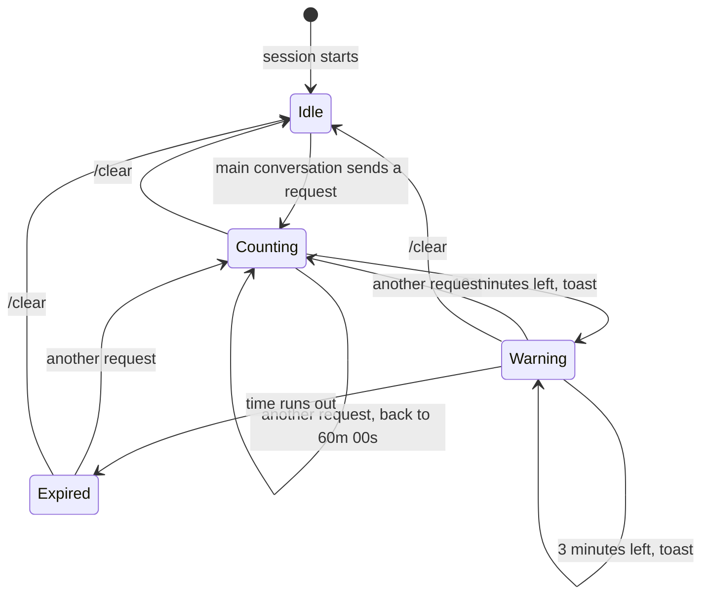

# cc-cache-timer

**A live countdown to prompt cache expiry, right in your Claude Code status line.**

[](LICENSE)


```text
⚠ cache-timer: 59m 42s left (until 03:09)
```

Claude Code caches your conversation so that each request only pays full price for what is new. That cache expires a fixed time after your last request. Come back one minute too late and the next message has to re-read the entire conversation from scratch: slower, and far heavier on your usage limit or your bill.

`cache-timer` shows you exactly how long you have left, and nudges you before the window closes.

## What you see

The status line under the prompt ticks down every second and always tells you the wall-clock time the cache runs out:

| Situation | Status line |
| --- | --- |
| Right after a request | `60m 00s left (until 03:09)` |
| Counting down | `42m 17s left (until 03:09)` |
| 10 minutes or less | `9m 58s left, expiring soon (until 03:09)` |
| Too late | `Cache expired at 03:09, next request re-reads everything` |

On top of that, a toast pops up once at **10 minutes** and once at **3 minutes** left:

```text
Prompt cache expires in 10m 00s (at 03:09). Send your next request before then to keep it.
```

## Features

- **Per-second countdown** with the exact expiry time, in your local time zone
- **Two early warnings** as toasts, at 10 and 3 minutes left, each shown only once per window
- **Clear expired state**, so you know before you hit Enter that the next request will be a cold one
- **Subagent aware**: requests from subagents use a separate cache and do not reset the timer
- **Resets on `/clear`**, since a cleared conversation has no cache worth keeping
- **Tiny and contained**: about 80 lines, no dependencies, and it only touches the clock, its own session state, the status line and toasts. No file system, network or process access

## Install

At the prompt of a Claude Code terminal session:

```text
/plugin install cache-timer --marketplace JinseongHwang/cc-cache-timer
```

Answer `y` to add the marketplace, then pick a scope (the user scope enables it in every session). The mod is active as soon as the install finishes.

From a shell:

```sh
claude plugin install cache-timer --marketplace JinseongHwang/cc-cache-timer
```

In the desktop app, where `/plugin` does not run: click **+** next to the prompt box, then **Plugins**, **Add marketplace** with `JinseongHwang/cc-cache-timer`, then **Add plugin**.

### Requirements

A Claude Code build that supports function hooks (mods). This mod was built and tested on Claude Code `2.1.319`. The hooks API is in early access and may change between releases, so a future release may require an update here.

### Update and uninstall

```sh
claude plugin update cache-timer@cc-cache-timer
claude plugin uninstall cache-timer@cc-cache-timer
```

## How it works

The mod is a single hooks module, [`hooks/register.ts`](hooks/register.ts), that listens to three events:

| Event | What the mod does |
| --- | --- |
| `session.start` | Starts a one-second tick that redraws the status line |
| `turn.step` | Records the time of every model request sent by the main conversation and restarts the countdown |
| `session.end` | Clears the timer when the session ends because of `/clear` |



The only thing it stores is the timestamp of the last request and which warnings it has already shown, declared in [`types/index.d.ts`](types/index.d.ts).

## Accuracy and limitations

- **It is an estimate, not a reading.** The timer measures the time since your last request and assumes a fixed lifetime. It does not ask the API whether the cache is actually still there.
- **It assumes a 1-hour TTL.** That is what the main conversation gets on a subscription plan. If your requests are cached for a different duration, for example the API's default of 5 minutes, change `TTL_MS` (see below) or the numbers will be wrong.
- **Only the main conversation is tracked.** Subagents have their own cache and are deliberately ignored.

Background reading: [Prompt caching](https://docs.claude.com/en/docs/build-with-claude/prompt-caching) in the Claude documentation.

## Customize

The knobs are three constants at the top of [`hooks/register.ts`](hooks/register.ts):

| Constant | Default | Meaning |
| --- | --- | --- |
| `TTL_MS` | `60 * 60 * 1000` | How long the cache is assumed to live after a request |
| `WARN_AT_MIN` | `[10, 3]` | Minutes left at which a toast is shown. The first value also turns on the `expiring soon` label |
| `TICK_MS` | `1000` | How often the status line is redrawn |

Clone the repository, edit the values, and run Claude Code with your copy:

```sh
git clone https://github.com/JinseongHwang/cc-cache-timer.git
claude --plugin-dir ./cc-cache-timer
```

## Development

```sh
claude --plugin-dir .       # start a session with the mod loaded from this folder
claude plugin validate .    # check the manifests and the hooks module the way the engine will
claude plugin test .        # run tests/*.test.ts
```

The test in [`tests/cache-timer.test.ts`](tests/cache-timer.test.ts) drives a mock clock through a full cycle: countdown, both warnings, expiry, and restart.

For type checking, the engine writes the API typings to `.claude-plugin/types/` (git-ignored) the first time it loads the mod from your folder. After that, `tsc -p .` works, because [`tsconfig.json`](tsconfig.json) extends the configuration written there.

```text
.
├── .claude-plugin/
│   ├── marketplace.json   # makes this repository installable as a marketplace
│   └── plugin.json        # the mod's manifest
├── hooks/
│   ├── hooks.json         # points the engine at the hooks module
│   └── register.ts        # the mod itself
├── tests/
│   └── cache-timer.test.ts
├── types/
│   └── index.d.ts         # the state contract
└── tsconfig.json
```

## Contributing

Issues and pull requests are welcome. Please run `claude plugin validate .` and `claude plugin test .` before opening a pull request.

## License

[MIT](LICENSE)
